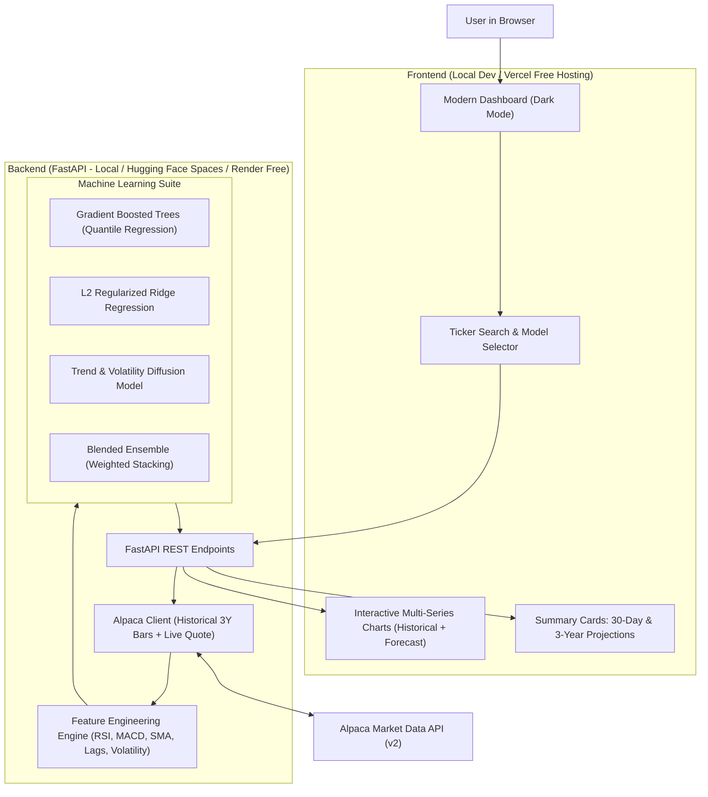

# Stock Price Forecasting Web App: Implementation Plan

An end-to-end blueprint for building a personal stock price forecasting website powered by **Alpaca Market Data APIs**, **Machine Learning** (Gradient Boosted Trees, Ridge Regression, Trend/Quantile Forecasts, and Blended Ensembles), and a decoupled modern web interface.

---

## 1. Project Architecture Overview

---

## 2. Core Features & Deliverables

1. **Ticker Search**:
   - Instant search for any US stock ticker (e.g. `AAPL`, `NVDA`, `MSFT`, `TSLA`, `SPY`).
   - Quick-select buttons for popular market benchmarks.
2. **Alpaca API Integration**:
   - Fetches **3 years of daily historical bars** (Open, High, Low, Close, Volume, VWAP).
   - Fetches **live market quotes** and latest trade prices during market hours.
3. **Machine Learning Models**:
   - **Gradient Boosted Trees (GBDT)**: Fast, non-linear pattern recognition with technical indicators.
   - **Ridge Regression**: Robust, regularized linear baseline preventing overfitting.
   - **Trend & Volatility Diffusion**: Long-term growth modeling with confidence cones.
   - **Blended Ensemble**: Weighted combination of models for maximal regime stability.
4. **Dual-Horizon Forecasting**:
   - **30-Day Daily Horizon**:
     - Daily expected trajectory.
     - **30-Day Summary**: Overall **Min**, **Max**, and **Mean** price for next 30 days.
   - **3-Year Monthly Horizon**:
     - 36 forward monthly intervals.
     - **Monthly Summary**: Table and chart showing predicted **Monthly Min**, **Monthly Max**, and **Monthly Mean** for each of the 36 months.
5. **Interactive UI**:
   - High-performance chart showing historical prices seamlessly connecting to the forecast curve with shaded Min-Max confidence bands.
   - Model selection toggle to compare GBDT vs. Ridge vs. Ensemble forecasts.
   - KPI cards for Current Price, 30-Day Expected Change, 30-Day Range, and 3-Year Trajectory.

---

## 3. Step-by-Step Implementation Roadmap

### Phase 1: Environment Setup & Alpaca API Client
- [ ] Initialize backend Python virtual environment and configure `requirements.txt`.
- [ ] Set up secure `.env` file for Alpaca credentials:
  - `ALPACA_API_KEY_ID`
  - `ALPACA_API_SECRET_KEY`
  - `ALPACA_BASE_URL` (Paper endpoint: `https://paper-api.alpaca.markets`)
  - `ALPACA_DATA_URL` (`https://data.alpaca.markets/v2`)
- [ ] Implement `alpaca_client.py`:
  - Fetch 3 years of daily OHLCV bars.
  - Fetch latest real-time quote/snapshot.
  - Implement caching to prevent redundant Alpaca API calls and rate-limiting.

### Phase 2: Feature Engineering & Preprocessing
- [ ] Implement `feature_builder.py`:
  - **Momentum Indicators**: Relative Strength Index (RSI 14), Rate of Change (ROC).
  - **Trend Indicators**: Simple Moving Averages (SMA 20, 50, 200), Exponential Moving Averages (EMA 12, 26), MACD line & signal.
  - **Volatility Indicators**: Bollinger Bands (Upper, Lower, Width), Average True Range (ATR), 30-day Rolling Volatility.
  - **Lagged & Autoregressive Features**: Lags of 1, 2, 3, 5, 10, 21 trading days.
  - **Calendar Features**: Day-of-week, month, quarter, day-of-year cyclical encodings.
- [ ] Resampling pipeline for 3-year monthly aggregation.

### Phase 3: Machine Learning Models & Forecasting Service
- [ ] **Quantile Gradient Boosted Trees**:
  - Implemented using Scikit-Learn's `HistGradientBoostingRegressor` with quantile loss (`loss="quantile"`).
  - Trains three regressors:
    - $\alpha = 0.10$ for **Min Price (Lower Band)**
    - $\alpha = 0.50$ for **Mean/Median Price (Expected Path)**
    - $\alpha = 0.90$ for **Max Price (Upper Band)**
- [ ] **Ridge Regression**:
  - L2-regularized linear model with polynomial lag features.
  - Produces stable baseline forecasts with residual standard error bands.
- [ ] **3-Year Monthly Diffusion & Trend Model**:
  - Fits long-term exponential/logarithmic trend on monthly aggregated data.
  - Incorporates volatility diffusion (drift + historical volatility scaling with $\sqrt{t}$) to calculate realistic monthly Min, Max, and Mean bounds over 36 months.
- [ ] **Blended Ensemble**:
  - Weighted combination of model outputs.
- [ ] **Forecasting Pipeline (`forecast_service.py`)**:
  - Orchestrates: Data Fetch $\to$ Features $\to$ Train Models $\to$ Predict 30 Days $\to$ Predict 36 Months $\to$ Format JSON Response.

### Phase 4: FastAPI REST API
- [ ] `GET /api/health`: Health status and Alpaca connection verification.
- [ ] `GET /api/search?q={query}`: Search ticker symbols with company name suggestions.
- [ ] `GET /api/stock/{ticker}/overview`: Current price, day's high/low, volume, 52-week range.
- [ ] `POST /api/stock/{ticker}/forecast`:
  - Request parameters: `model` (`ensemble`, `gbdt`, `ridge`), `include_monthly` (boolean).
  - Response payload:
    - Historical bars (past 3 years dates & prices).
    - Next 30 days daily forecast (date, min, mean, max).
    - 30-day summary metrics (`min_price`, `max_price`, `mean_price`, `expected_change_pct`).
    - Next 36 months forecast (year-month, monthly min, monthly mean, monthly max).

### Phase 5: Modern Interactive UI
- [ ] Clean, dark-mode, responsive dashboard.
- [ ] Ticker search bar with quick-pick chips (AAPL, NVDA, TSLA, MSFT, GOOGL).
- [ ] Interactive multi-series chart:
  - Historical price curve (solid line).
  - 30-Day forecast (dashed line).
  - Min/Max forecast envelope (shaded semi-transparent confidence area).
- [ ] Key Metric Cards:
  - Current Price & Today's Change.
  - 30-Day Projected Mean, Min, and Max.
  - Projected 30-Day ROI (%).
- [ ] 3-Year Monthly Forecast Section:
  - Interactive multi-year projection chart.
  - Sortable/filterable table showing all 36 months with Monthly Min, Mean, and Max prices.
- [ ] Model selector dropdown allowing instant switching between GBDT, Ridge, and Ensemble.

### Phase 6: Backtesting & Verification
- [ ] Backtest evaluation on out-of-sample data.
- [ ] Measure Mean Absolute Error (MAE), Root Mean Squared Error (RMSE), and Directional Accuracy.
- [ ] Verify handling of market holidays, weekends, and non-trading days.

### Phase 7: Free Deployment Guide
- [ ] **Backend Deployment (Free Tier)**:
  - Dockerize backend with production `uvicorn` and `FastAPI`.
  - Deploy to **Hugging Face Spaces** (Free Docker container with 16 GB RAM and 2 vCPUs) or **Render.com**.
  - Configure production environment variables (`ALPACA_API_KEY_ID`, `ALPACA_API_SECRET_KEY`).
- [ ] **Frontend Deployment (Free Tier on Vercel)**:
  - Deploy frontend to **Vercel** with one click or CLI.
  - Set `NEXT_PUBLIC_API_BASE_URL` pointing to backend.
  - Configure CORS origins on backend to allow Vercel domain.

