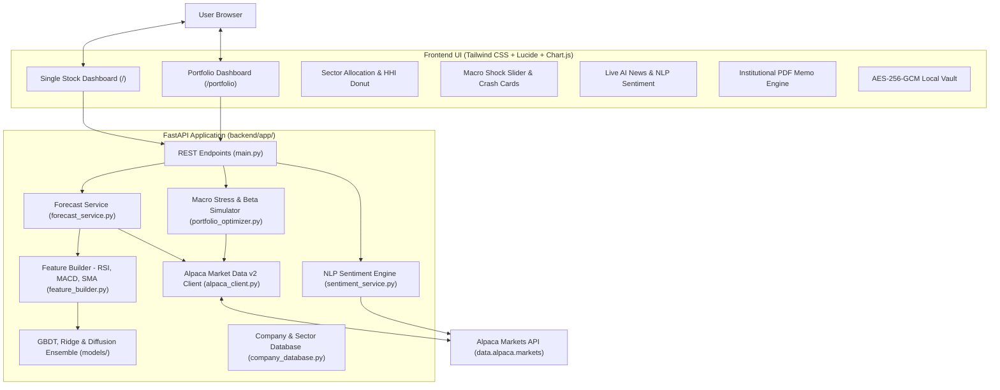

# StockCast ML: Institutional-Grade Stock & Portfolio Price Forecasting Application

An advanced quantitative forecasting and portfolio risk intelligence platform powered by **Alpaca Market Data API (v2)**, **Machine Learning** (Quantile Gradient Boosted Trees, Regularized Ridge Regression, Geometric Volatility Diffusion, and Blended Ensembles), **Pre-IPO & Unlisted Asset Tracking**, **Macro Stress-Testing**, **Real-Time Financial NLP Sentiment Analysis**, and a responsive Apple-glass interactive dashboard.

---

## 🌟 Comprehensive Feature Suite

### 1. 🦄 Pre-IPO & Unlisted Asset Baseline Tracking (e.g. Anthropic ANT, Stripe, SpaceX)
* **Unlisted Asset Integration**: Add private, pre-IPO, or OTC stock positions (such as Anthropic `ANT` ahead of its Nov 19 IPO, `STRIPE`, or `SPACEX`) with custom purchase prices and share quantities.
* **Full Capital & Horizon Inclusion**: Invested capital ($3,900 for 50 shares @ $78) is accurately credited across **all portfolio totals**:
  * Total Invested Cost Basis (`$3,900.00`)
  * Current Portfolio Valuation (`$3,900.00`)
  * Critical Hard Support Floor (`$3,900.00`)
  * 60-Day Aggregate Daily Forecast Envelope
  * 3-Year Multi-Year Monthly Projections
* **Pre-IPO Baseline Reporting**: Displays clear `Pre-IPO Baseline` badges in holding tables and prevents missing data or crash errors.

### 2. 📰 Real-Time AI News & Financial NLP Sentiment Analysis
* **Live Market Wires**: Directly ingests real-time breaking market news via Alpaca's news stream.
* **Quantitative Financial NLP Lexicon**: Scores headlines and summaries from **-100 (Very Bearish)** to **+100 (Very Bullish)** using institutional finance sentiment dictionaries.
* **Catalyst & Trigger Extraction**: Highlights positive and negative keyword triggers (e.g. *earnings beat, breakout, upgrade, inflation, subpoena*).
* **Wire Previews & Polarity Badges**: Displays article summaries, timestamps, sources (Benzinga, MarketWire), and direct external links.

### 3. ⚡ Macro Stress-Testing & Market Crash Simulator
* **CAPM Beta Modeling**: Computes individual holding and aggregate portfolio Betas ($\beta$) against the S&P 500 benchmark (`SPY`).
* **Pre-Built Systemic Shock Scenarios**:
  * 📉 **S&P 500 Market Correction (-10%)**
  * 🐻 **Severe Recession / Tech Crash (-20%)**
  * 🚀 **Growth & AI Expansion Bull Surge (+15%)**
  * 🏦 **Fed Rate Cut Easing / Soft Landing (+6%)**
* **Interactive Shock Slider**: Test custom macroeconomic shocks anywhere from **-30% to +30%** with instantaneous live calculations of portfolio dollar impact, percentage change, and stressed valuation.

### 4. 🍩 Sector Allocation Donut Chart & Concentration Risk Guardrail
* **Interactive Chart.js Donut**: Visualizes exact distribution across Technology, Semiconductors, Financials, Healthcare, Consumer Discretionary, etc.
* **Herfindahl-Hirschman Index (HHI)**: Computes quantitative market concentration ($HHI = \sum w_i^2$) and provides guardrail warnings (*Optimal Diversification*, *Moderate Concentration*, or *High Concentration Alert*) to protect against over-allocation.

### 5. 🛡️ Critical Support Floor Alerts & Breakout Levels
* **Downside Floor Defense**: Computes empirical 99% critical support floors on both individual equities and composite portfolios.
* **Buffer & Cushion Metrics**: Displays dollar distance and percentage downside cushion to notify investors before key technical support breaks.
* **Chart Integration**: Shaded red support line toggleable directly on both the 30-Day and 3-Year forecast charts.

### 6. 📅 Earnings Catalyst & Event Milestone Tracker
* **Upcoming Earnings Tracker**: Displays next projected earnings report dates and countdowns directly on the stock overview banner.
* **Volatility Expectations**: Highlights historical post-earnings move percentages and implied options straddle moves.

### 7. 📄 1-Click Institutional PDF Investment Memorandum
* **Executive Print Engine**: Clean `@media print` CSS rules transform the interactive dashboard into a clean, 2-column institutional PDF memorandum.
* **Confidentiality & Compliance**: Auto-renders header logos, disclaimers, date stamps, and structured tables while hiding web navigation controls.

### 8. 💼 Owned Stocks Dedicated Portfolio Page (`/portfolio`)
* **Aggregate Forecasting**: Computes composite 60-day daily trajectories and 3-year multi-year monthly CAGR across all owned positions.
* **Zero Remote Database**: Portfolio positions are stored **100% locally in your browser**.
* **Client-Side AES-256-GCM Vault**: Optional PIN lock encrypts holdings using PBKDF2 with 100,000 iterations.
* **Privacy Shield Mask**: Toggleable one-click balance blur for shoulder-surfing protection in public.
* **Position Management**: Edit quantities, record partial buys/sells with weighted cost-basis recalculation, and export/import JSON backups or CSVs.

### 9. 🚀 Automatic Live Pre-IPO & Asset Discovery (e.g. Anthropic, Stripe)
* **Dynamic Alpaca Asset Sync**: Synchronizes with Alpaca's active asset registry on startup to discover newly listed IPOs the day they debut.
* **Pre-IPO Synthetic Padding**: Prevents "insufficient data" errors on newly listed equities (< 50 bars) via price-discovery baseline padding.

### 10. 🤖 Multi-Model Machine Learning Suite
* **Quantile Gradient Boosted Trees (GBDT)**: Pinball quantile loss regressors predicting 10th percentile (Min), 50th percentile (Mean), and 90th percentile (Max) envelopes.
* **Regularized Ridge Regression**: L2-penalized baseline model with analytical variance intervals.
* **Blended Ensemble**: Adaptive stacking blending GBDT and Ridge for optimal out-of-sample stability.
* **Multi-Horizon Diffusion**: 30-day continuous daily forecasts and 36-month geometric trend drift.

### 11. ⏱️ 10-Minute Synchronized Pricing, Eastern Time Displays & Sequential Queue
* **Synchronized 10-Minute Cadence**: Automatic price streaming aligned strictly to wall-clock marks (`:00, :10, :20, :30, :40, :50`), eliminating excessive request bursts and server load.
* **Eastern Time (`ET`) & Local Timestamps**: Displays formatted timestamps in US Eastern Time (`Last Updated: 1:30 PM ET`, `As of Nov 11, 2026 01:30 PM ET`) on top header badges, single stock quote cards, and individual owned positions, eliminating confusing UTC timestamps.
* **Sequential Queue Processing**: Multi-asset portfolio calculations are processed one-by-one in an orderly queue with explicit memory deallocation (`gc.collect()`), keeping peak RAM under 200 MB.
* **Strict 2 vCPU / 1000 MB RAM Guardrails**: Hard-caps OpenMP/MKL thread pools (`OMP_NUM_THREADS=1`) and serializes requests via `asyncio.Lock` to guarantee stability and prevent container OOM termination on Railway.

### 12. 🎨 Interactive Fintech Visualizations & UX Micro-Animations
* 🏎️ **Animated Speedometer / Tachometer Sentiment Gauge**: Visual semi-circular SVG dial with Bearish-to-Bullish gradient and smooth spring needle sweep (`cubic-bezier(0.34, 1.56, 0.64, 1)`) reflecting real-time NLP sentiment scores from -100 to +100.
* 🔢 **Apple / Robinhood-Style Rolling Numbers & Flash Pulse Glow**: Eased cubic count-up animations for prices, valuations, and metrics with instantaneous green/rose glowing pulse rings (`.flash-emerald`, `.flash-rose`) on 10-minute price updates.
* 🎯 **Interactive Timeline Scrubber & Enhanced Crosshair Tooltips**: Crosshair cursor hover showing day/month indices, expected ROI%, dollar gains, and volatility spread bounds.
* 📈 **Mini SVG Trend Sparklines**: Inline SVG sparklines next to each ticker badge in the portfolio table with positive green fills, negative red trends, or dashed neutral baselines for pre-IPO / unlisted assets.
* 🗺️ **Asset Risk vs. Expected Return Bubble Matrix (2D Scatter Plot)**: Quadrant scatter chart plotting portfolio holdings by risk/volatility spread (X-axis) against expected 60-day return (Y-axis), categorized into *Growth Anchors*, *Defensive Rocks*, *High-Beta Growth*, and *Laggards*, with bubble sizes scaled by portfolio weight.
* 🏆 **Financial Goal Milestone & Time-to-Target Calculator**: Set target milestones ($25K, $50K, $100K, $250K, $1M) with interactive sliders, animated progress bars, and compound annual growth rate (CAGR) countdown dates predicting the exact month your goal will be reached.
* ⌨️ **Quick Command Palette / Spotlight Search (`⌘K` / `Ctrl+K` / `/`)**: Modal search overlay for instant ticker lookups, quick page jumps, dark mode toggles, and PDF/CSV exports with arrow key navigation.
* 🔔 **Live Market Clock & Circular NYSE Session Progress Ring**: Real-time US Eastern Time countdown clock with an animated circular SVG ring displaying the percentage of the current trading day elapsed.

---

## 🏗️ Architecture Overview



---

## 📁 Codebase Directory Structure

```text
stock-forecast/
├── backend/
│   ├── app/
│   │   ├── alpaca_client.py       # Alpaca Market Data v2 client with IEX feed & cache
│   │   ├── company_database.py    # Sector mapping, IPO sync, and ticker autocomplete
│   │   ├── config.py              # Environment variables, Alpaca credentials, reload config
│   │   ├── feature_builder.py     # RSI, MACD, SMA, Bollinger, Volatility, Lags
│   │   ├── forecast_service.py    # Pipeline coordinator (Single stock & Portfolio aggregation)
│   │   ├── main.py                # FastAPI endpoints, CORS, static routes, health checks
│   │   ├── portfolio_optimizer.py # CAPM Betas & Macro Stress tests
│   │   ├── sentiment_service.py   # Alpaca live news API & financial NLP sentiment engine
│   │   └── models/
│   │       ├── gbdt_model.py      # Quantile HistGradientBoostingRegressor (10%, 50%, 90%)
│   │       ├── ridge_model.py     # L2 Regularized Ridge with residual standard error
│   │       ├── long_term_model.py # 3-Year Monthly trend drift & volatility cones
│   │       └── ensemble.py        # Consensus weighted blending
├── frontend/
│   ├── index.html                 # Sleek single stock dashboard with news sentiment & PDF export
│   ├── portfolio.html             # Dedicated portfolio manager with sector donut & simulator
│   ├── app.js                     # Single stock UI interactions, Chart.js instances, live sync
│   ├── portfolio.js               # Portfolio calculations, AES vault, crash slider
│   └── style.css                  # Apple-glass design, glowing badges, print stylesheet
├── Dockerfile                     # Production container spec (Python 3.14 + Uvicorn)
├── railway.json                   # Railway deployment configuration
├── requirements.txt               # Backend Python dependencies
├── .env.example                   # Template environment file
└── README.md                      # Comprehensive application documentation
```

---

## 📡 REST API Reference

| Endpoint | Method | Description |
| :--- | :---: | :--- |
| `/api/stock/{ticker}/forecast?model={model}` | `GET` | 30-day and 3-year ML forecasts, support floors, earnings catalyst, and news sentiment for a ticker. |
| `/api/stock/{ticker}/news` | `GET` | Live Alpaca breaking news wire, NLP sentiment score (-100 to +100), and top catalyst triggers. |
| `/api/search?q={query}` | `GET` | Real-time autocomplete searching company names and tickers. |
| `/api/portfolio/forecast` | `POST` | Aggregated 60-day & 3-year portfolio forecast, sector donut, concentration risk, and support floor defense. |
| `/api/portfolio/stress-test` | `POST` | Simulates custom S&P 500 macro shocks (-30% to +30%) on portfolio equity using holding Betas. |
| `/api/health` | `GET` | System health check and US market session status (Pre-Market, Regular, After-Hours, Closed). |

---

## 🚀 Running Locally

```bash
# 1. Clone the repository
git clone https://github.com/nik-khurana/stock-forecast.git
cd stock-forecast

# 2. Create and activate a Python virtual environment
python3 -m venv venv
source venv/bin/activate

# 3. Install dependencies
pip install -r requirements.txt

# 4. Set up environment variables (.env)
cp .env.example .env
# Edit .env with your Alpaca API credentials:
# ALPACA_API_KEY_ID=your_key_id
# ALPACA_API_SECRET_KEY=your_secret_key

# 5. Start the FastAPI development server
uvicorn backend.app.main:app --host 127.0.0.1 --port 8000 --reload
```

Open your browser to:
* Single Stock Dashboard: **[http://127.0.0.1:8000](http://127.0.0.1:8000)**
* Portfolio Dashboard: **[http://127.0.0.1:8000/portfolio](http://127.0.0.1:8000/portfolio)**

---

## ☁️ Production Deployment

### Deploying to Railway
This project is configured with a production [`Dockerfile`](file:///Users/nikhil/Desktop/stock-forecast/Dockerfile) and [`railway.json`](file:///Users/nikhil/Desktop/stock-forecast/railway.json).
1. Link your GitHub repository in the [Railway Dashboard](https://railway.app).
2. Set Environment Variables:
   * `ALPACA_API_KEY_ID`: Your Alpaca API Key ID
   * `ALPACA_API_SECRET_KEY`: Your Alpaca Secret Key
   * `PORT`: `8000` (auto-bound by Railway)
3. Deploy! Railway will automatically build the Docker container and route incoming HTTPS traffic.

---

## 🔒 Security & Privacy Notice
* **Local Data Isolation**: Financial positions entered on `/portfolio` are stored locally in your browser's `localStorage` and never persisted to an external database.
* **Zero Tracking**: Calculations run in transient server memory and are immediately discarded.
* **Paper Credentials**: Works seamlessly with free Alpaca Paper Trading API keys.
