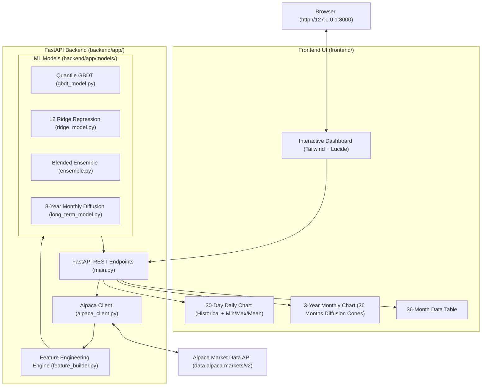

# StockCast ML: Personal Stock Price Forecasting Application

An intelligent stock price forecasting web application powered by **Alpaca Market Data API (v2)**, **Machine Learning** (Quantile Gradient Boosted Trees, Regularized Ridge Regression, Long-Term Trend & Volatility Diffusion, and Blended Ensembles), and a modern dark-mode interactive dashboard.

---

## 🌟 Key Features

1. **Alpaca Market Data v2 Integration**:
   - Ingests **3 years of daily historical bars** (750+ trading sessions: Open, High, Low, Close, Volume, VWAP).
   - Retrieves **live market quotes** and snapshot changes during market hours.
2. **Machine Learning Forecasting Suite**:
   - **Gradient Boosted Trees (GBDT)**: Pinball quantile loss regressors predicting 10th percentile (Min), 50th percentile (Mean), and 90th percentile (Max) paths.
   - **Ridge Regression**: L2-regularized linear baseline with residual variance uncertainty bounds.
   - **Blended Ensemble**: Consensus stacking combining GBDT and Ridge for maximal regime stability.
3. **Dual-Horizon Forecasting**:
   - **Next 30 Days (Daily Horizon)**:
     - Predicted daily trajectory connecting directly to historical closes.
     - 30-Day aggregate summary: **Min Price**, **Max Price**, **Mean Price**, and Expected ROI %.
   - **Next 3 Years (Monthly Horizon - 36 Months)**:
     - Monthly aggregated trend drift and volatility diffusion cones.
     - Year 1, Year 2, and Year 3 summary projections + 3-year projected CAGR.
     - Interactive 36-month table with sortable columns for Monthly Min, Mean, Max, and Volatility Spread.
4. **Interactive Dashboard**:
   - Instant search for any US ticker (`AAPL`, `NVDA`, `TSLA`, `MSFT`, `SPY`, etc.).
   - Model selector tabs allowing instant toggling between Ensemble, GBDT, and Ridge without re-fetching.
   - High-performance financial charts built with Chart.js.

---

## 🏗️ Architecture Overview



---

## 📁 Codebase Directory Structure

```text
stock-forecast/
├── backend/
│   ├── app/
│   │   ├── config.py              # Environment variables, Alpaca URLs, reload logic
│   │   ├── alpaca_client.py       # Alpaca Market Data v2 client with IEX feed & cache
│   │   ├── feature_builder.py     # RSI, MACD, Moving Averages, Bollinger, Volatility, Lags
│   │   ├── models/
│   │   │   ├── gbdt_model.py      # Quantile HistGradientBoostingRegressor (10%, 50%, 90%)
│   │   │   ├── ridge_model.py     # L2 Regularized Ridge with residual standard error
│   │   │   ├── long_term_model.py # 3-Year Monthly trend drift & volatility cones
│   │   │   └── ensemble.py        # Consensus weighted blending
│   │   ├── forecast_service.py    # Pipeline coordinator & response formatter
│   │   └── main.py                # FastAPI routes, CORS, static file serving
├── frontend/
│   ├── index.html                 # Sleek dark-mode dashboard
│   ├── app.js                     # State management, Chart.js multi-series alignment
│   └── style.css                  # Custom glassmorphism, glowing badges, scrollbars
├── .env                           # Private Alpaca API credentials (never committed)
├── .env.example                   # Template environment file
├── requirements.txt               # Backend dependencies
└── IMPLEMENTATION_PLAN.md         # Full project architectural roadmap
```

---

## 🚀 Running Locally

The local server is already running! To start or restart it at any time:

```bash
# 1. Activate the virtual environment
source venv/bin/activate

# 2. Run the FastAPI server with hot-reload
uvicorn backend.app.main:app --host 127.0.0.1 --port 8000 --reload
```

Open your browser to:
**[http://127.0.0.1:8000](http://127.0.0.1:8000)**

---

## ☁️ Free Deployment Guide (Vercel + Hugging Face / Render)

To deploy this application 100% free:

### 1. Deploy Backend (FastAPI on Hugging Face Spaces or Render)
- **Hugging Face Spaces (Recommended - 100% Free)**:
  1. Create a free account on [huggingface.co](https://huggingface.co).
  2. Create a new Space with the **Docker** SDK.
  3. Upload the `backend/` folder and `requirements.txt`.
  4. In Space Settings $\to$ Variables and Secrets, add:
     - `ALPACA_API_KEY_ID`: Your Alpaca Key ID
     - `ALPACA_API_SECRET_KEY`: Your Alpaca Secret Key
  5. Your backend will have a free, live HTTPS URL (e.g., `https://your-user-stockcast.hf.space`).
- **Render.com**:
  1. Create a free Web Service on [render.com](https://render.com).
  2. Connect your GitHub repository.
  3. Set Build Command: `pip install -r requirements.txt`
  4. Set Start Command: `uvicorn backend.app.main:app --host 0.0.0.0 --port $PORT`
  5. Add your Alpaca environment variables.

### 2. Deploy Frontend (Vercel or Netlify)
1. Push the `frontend/` folder to GitHub or deploy via Vercel CLI.
2. In `frontend/app.js`, update the API base URL to point to your live backend URL (or use environment variables).
3. Connect your repository to Vercel/Netlify for instant global CDN hosting.

